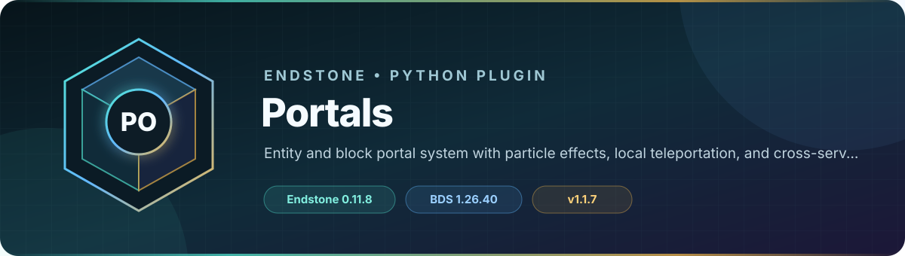

<!-- endstone-professional-header:start -->
<p align="center">
  
</p>

<p align="center">
  <a href="https://github.com/TheNINJALLO/endstone-portals/actions/workflows/wheel-release.yml"></a>
  <a href="https://github.com/TheNINJALLO/endstone-portals/releases/latest"></a>
</p>

<p align="center">
  
  
  
  =3.10" src="https://img.shields.io/badge/Python-%3E=3.10-3776AB?style=flat-square&amp;logo=python&amp;logoColor=white">
</p>

<p align="center">
  <strong>Entity and block portal system with particle effects, local teleportation, and cross-server transfers.</strong>
</p>

<p align="center">
  <a href="#what-it-does">What it does</a> &bull;
  <a href="#how-to-use">How to use</a> &bull;
  <a href="#commands-and-permissions">Commands</a> &bull;
  <a href="#install">Install</a> &bull;
  <a href="https://github.com/TheNINJALLO/endstone-portals/releases">Releases</a>
</p>

## Overview

Entity and block portal system with particle effects, local teleportation, and cross-server transfers. This release is aligned with Endstone 0.11.8 and Minecraft Bedrock Dedicated Server 1.26.40, and is distributed as a Python wheel for direct installation in an Endstone server.

## What it does

- Creates entity-activated and block-frame portals through in-game forms.
- Supports local dimension teleports and cross-server transfers with loop protection.
- Adds particle effects, persistent definitions, and frame-block protection for non-operators.

## How to use

1. Run `/portal` as an operator and choose whether to create an entity or block portal.
2. Set the activation target/frame and choose either local coordinates or a remote server destination.
3. Test the portal in both directions, then use `/portal list` to verify the stored definition.
4. Use `/portal reload` after manual data edits or `/portal delete <name>` to remove a portal cleanly.

## Commands and permissions

| Command / usage | What it does | Access |
|---|---|---|
| `/portal`<br>`/portal reload`<br>`/portal list`<br>`/portal delete <name: str>` | Portal management commands | `portals.admin` |

## Compatibility

| Component | Supported version |
|---|---|
| Endstone | `0.11.8` |
| Endstone API | `0.11` |
| Bedrock Dedicated Server | `1.26.40` |
| Python | `>=3.10` |
| Plugin release | `v1.1.7` |

## Install

Download the wheel from the matching GitHub release:

```bash
gh release download v1.1.7 --repo TheNINJALLO/endstone-portals --pattern "*.whl"
```

Copy the downloaded wheel into the server's `plugins/` directory, remove any older wheel for the same plugin, and restart Endstone.

> [!IMPORTANT]
> Use Endstone `0.11.8` with BDS `1.26.40`. Back up worlds and plugin data before upgrading a production server.

## Configuration and secrets

Runtime databases, logs, local `.env` files, server directories, and root `config.toml` files are excluded from source releases. When an example configuration is provided, copy it locally and keep live tokens, passwords, webhook URLs, and server identifiers out of Git.

## Release automation

Every `v*` tag runs [the wheel release workflow](.github/workflows/wheel-release.yml), builds the package in a clean GitHub runner, stores the wheel as a workflow artifact, and attaches it to the matching GitHub release.
<!-- endstone-professional-header:end -->
